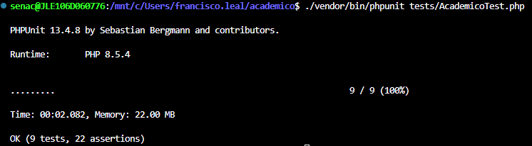

# API REST - Situação Acadêmica

## Autor
Francisco Bandel Leal

## Descrição
Este projeto consiste em uma API REST desenvolvida em PHP utilizando o framework Slim 4. A API permite realizar operações relacionadas à situação acadêmica dos alunos, incluindo cadastro, consulta, atualização e exclusão de registros.

## Tecnologias utilizadas
- PHP
- Slim Framework 4
- Composer
- PHPUnit
- JSON
- Postman

## Funcionalidades

### 1. Cadastrar situação acadêmica
- Método: POST
- Rota: `/situacao`
- Função: cadastrar uma nova situação acadêmica.

### 2. Consultar situação acadêmica
- Método: GET
- Rota: `/situacao/{id}`
- Função: buscar uma situação acadêmica pelo identificador.

### 3. Atualizar situação acadêmica
- Método: PUT
- Rota: `/situacao/{id}`
- Função: atualizar o campo `aprovado` de uma situação existente.

### 4. Excluir situação acadêmica
- Método: DELETE
- Rota: `/situacao/{id}`
- Função: excluir uma situação acadêmica pelo identificador.

## Estrutura do projeto

```text
situacao-academica/
├── public/
│   └── index.php
├── src/
│   └── app.php
├── storage/
│   └── situacoes.json
├── tests/
│   └── SituacaoTest.php
├── imagens/
│   └── image.png
├── vendor/
├── composer.json
├── composer.lock
├── README.md
└── .gitignore
```

## Como executar o projeto

### 1. Instalar as dependências

```bash
composer install
```

### 2. Iniciar o servidor

```bash
php -S localhost:8081 -t public public/index.php
```

### 3. Acessar a API

`http://localhost:8081`

## Testes automatizados

Os testes foram desenvolvidos utilizando PHPUnit para verificar o funcionamento dos endpoints, incluindo cadastro, consulta, atualização e exclusão de situações acadêmicas.

Para executar os testes:

```bash
./vendor/bin/phpunit tests/SituacaoTest.php
```

### Resultado dos testes automatizados

A imagem abaixo apresenta o resultado da execução dos testes automatizados da API.



## Códigos HTTP utilizados

- 200: Requisição realizada com sucesso.
- 201: Registro criado com sucesso.
- 404: Registro não encontrado.
- 422: Dados enviados inválidos.

## Considerações finais

O desenvolvimento desta API permitiu aplicar conhecimentos sobre APIs REST, métodos HTTP, manipulação de dados JSON, rotas com Slim Framework e testes automatizados com PHPUnit.
